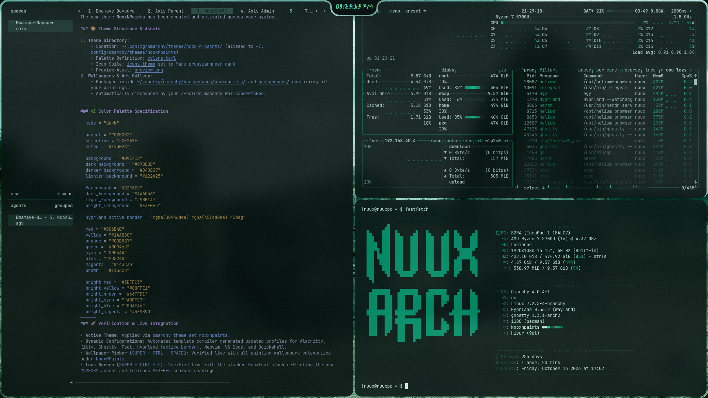

# Nooxnpaints 🎨🌲

A lush, mineral-green and luminous seafoam dark theme paired with fine oil painting wallpapers for [Omarchy](https://omarchy.org/) and Hyprland.



---

## 📦 Installation

### Quick Install (Terminal)

Run the following command in your terminal:

```bash
omarchy theme install https://github.com/whonoox/omarchy-nooxnpaints-theme.git
```

*(Alternatively: `omarchy-theme-install https://github.com/whonoox/omarchy-nooxnpaints-theme.git`)*

### Via Omarchy Menu
1. Press `Super + Alt + Space` to open the Omarchy menu.
2. Navigate to **Install** > **Style** > **Theme**.
3. Paste:
   ```text
   https://github.com/whonoox/omarchy-nooxnpaints-theme.git
   ```

---

## 🎨 Color Palette

| Token | Hex / Value | Description |
| :--- | :--- | :--- |
| **Accent** | `#52E0B2` | Bright luminous seafoam highlight |
| **Selection** | `#0F241F` | Deep forest-teal background |
| **Muted** | `#14302A` | Subdued dark mineral green divider/border |
| **Background** | `#091412` | Core workspace surface |
| **Dark Background** | `#070E0D` | Dark spruce-mineral backplane |
| **Darker Background** | `#040807` | Deepest shadow floor |
| **Lighter Background** | `#122A25` | Elevated card & panel surface |
| **Foreground** | `#D2F6EC` | Organic pale minty-white body text |
| **Bright Foreground** | `#E3FBF5` | Pale seafoam-white headings |
| **Light Foreground** | `#90B1A7` | Desaturated sage-green secondary labels |
| **Dark Foreground** | `#446056` | Desaturated foliage-green tertiary & placeholder |
| **Active Border** | `rgba(00946dee) rgba(45fcd0ee) 45deg` | Seamless 45° transition from NuuXGreen to vibrant seafoam |

### Terminal ANSI Colors

| Role | Standard | Bright |
| :--- | :--- | :--- |
| **Black** | `#091412` | `#122A25` |
| **Red** | `#006B4D` | `#3DFFC3` |
| **Green** | `#00946D` | `#66FFD1` |
| **Yellow** | `#1AA880` | `#88FFE1` |
| **Blue** | `#2D524A` | `#8DAFA6` |
| **Magenta** | `#143C34` | `#6E9B90` |
| **Cyan** | `#00E5AA` | `#A8FFE7` |
| **White** | `#D2F6EC` | `#E3FBF5` |

---

## 🖼️ Included Art Wallpapers

The theme includes 8 artworks curated specifically for this palette:
- `1.HIV-AIDS.jpeg`
- `2.lalibela.jpeg` (Rock-hewn churches of Lalibela)
- `3.SofUmar.jpeg` (Sof Omar Caves)
- `4.Taxi.jpeg` (Blue/green minibus taxi)
- `5.Tiya.jpeg` (Tiya Megalithic Stelae)
- `paintings5.jpg` (Textured canvas)
- `paintings13.jpg` (Pagoda & serene heron)
- `trimmed.webp` (Abstract luminous wave)

Switch wallpapers anytime using `Super + Ctrl + Space` (Wallpaper Picker) or `omarchy theme bg next`.

---

## 📄 License

MIT © [NooX](https://github.com/whonoox)
